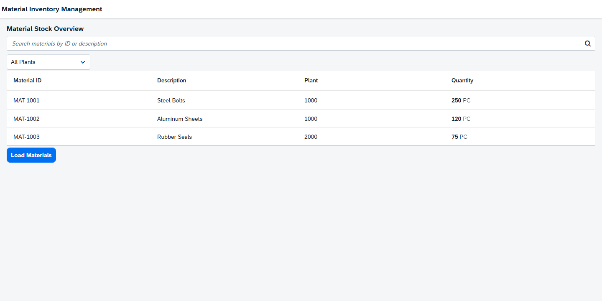
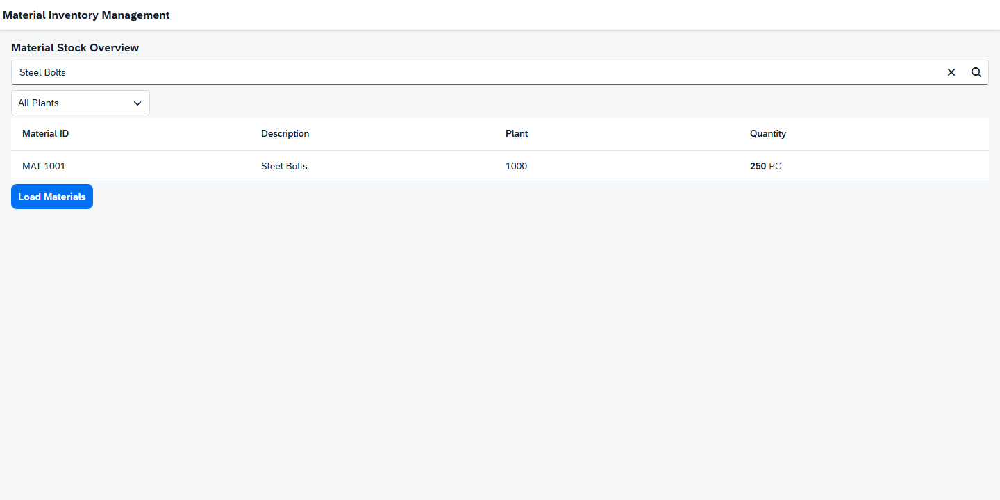
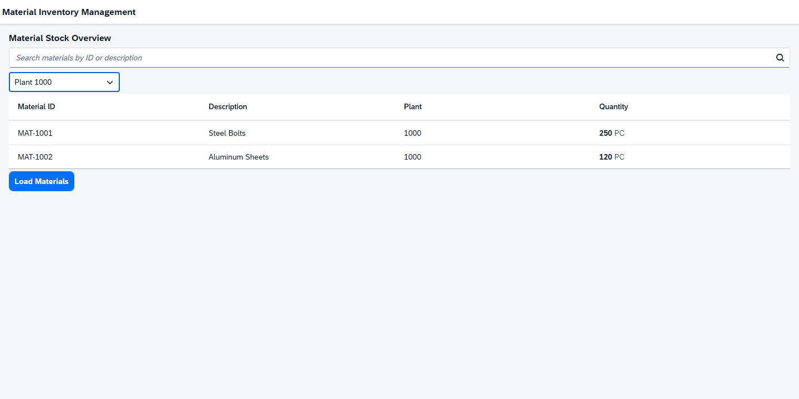
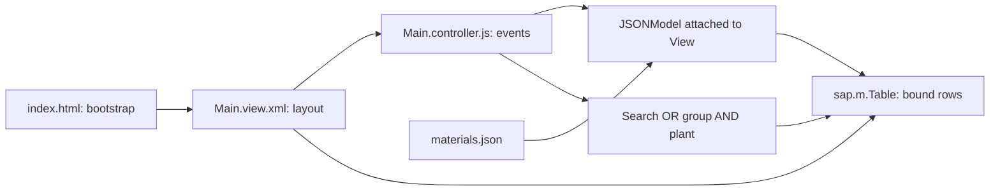

# Material Inventory Management

An OpenUI5 portfolio application for reviewing material stock across plants. It demonstrates SAPUI5 MVC concepts, XML Views, JavaScript Controllers, JSONModel binding, and combined client-side filters.

Inventory staff can review material IDs, descriptions, plants, quantities, and units, then narrow the table by material or plant. The app uses three fictional records from a local JSON file. It has no SAP ECC, S/4HANA, RAP, OData, or other backend connection.

## Application screenshots

### Inventory overview



### Material search

Searching for `Steel Bolts` returns one material.



### Plant filter

Plant 1000 contains Steel Bolts and Aluminum Sheets.



### Combined filters

Both the Steel Bolts search and Plant 1000 selection apply.


Screenshots were captured from the running application using Playwright and headless Chrome.

## Features

- Review inventory in a `sap.m.Table`, including quantity and unit.
- Search as you type by material ID or description; surrounding whitespace is trimmed.
- Select Plant 1000, Plant 2000, or All Plants.
- Combine search and plant filtering. Clear the search and select All Plants to restore all rows.
- Use standard responsive `sap.m` controls with the SAP Fiori Horizon theme. Custom mobile column pop-ins are not configured.
- Click **Load Materials** to show a confirmation toast. This button does not fetch or refresh data; data loads automatically at initialization.

## Technology stack

| Technology | Role |
| --- | --- |
| OpenUI5 1.153.0 | UI framework configured in ui5.yaml |
| JavaScript | Controller and bootstrap |
| XML Views | Declarative controls and bindings |
| JSONModel | Local inventory data |
| UI5 Tooling / CLI 4 | Development server |
| SAP Fiori Horizon (`sap_horizon`) | Theme |

## Architecture



The View declares controls, bindings, and event handlers. The Controller initializes data and filters the table binding. The Model holds inventory values and supplies them through binding contexts.

`index.html` bootstraps UI5 and creates the XML View directly. `manifest.json` declares application identity and dependencies; the current app has no Component or manifest-driven routing.

```text
ui5-material-inventory/
├── docs/screenshots/
├── webapp/
│   ├── controller/Main.controller.js
│   ├── model/materials.json
│   ├── view/Main.view.xml
│   ├── index.html
│   └── manifest.json
├── .gitignore
├── LICENSE
├── README.md
├── package.json
├── package-lock.json
└── ui5.yaml
```

## Technical implementation

### Model initialization and inheritance

In `onInit`, the Controller loads the local JSON resource and attaches an unnamed default model to the View:

```javascript
const oModel = new JSONModel();
oModel.loadData(
  sap.ui.require.toUrl(
    "com/portfolio/materialinventory/model/materials.json",
  ),
);
this.getView().setModel(oModel);
```

Child controls inherit the model from the View. The JSON file contains a root `materials` array; there is no remote data service.

### Aggregation binding and row contexts

The table binds its `items` aggregation to the absolute path `/materials`:

```xml
<Table id="materialsTable" items="{/materials}">
```

UI5 clones the row template for each array entry and assigns each row a context such as `/materials/0`. Relative cell bindings resolve against that context:

```xml
<ColumnListItem>
    <cells>
        <Text text="{materialId}" />
        <Text text="{description}" />
        <Text text="{plant}" />
        <ObjectNumber number="{quantity}" unit="{unit}" />
    </cells>
</ColumnListItem>
```

For example, `{description}` in the first row resolves to `/materials/0/description`.

### Search and plant filtering

The SearchField `liveChange` event calls `onSearch`; the Select `change` event calls `onFilterChange`. Both delegate to `applyFilters`, which reads the current values.

Search combines two `Contains` filters using OR:

```javascript
new Filter({
  filters: [
    new Filter("materialId", FilterOperator.Contains, sQuery),
    new Filter("description", FilterOperator.Contains, sQuery),
  ],
  and: false,
})
```

Selecting a specific plant adds an equality filter:

```javascript
if (sPlant && sPlant !== "ALL") {
  aFilters.push(new Filter("plant", FilterOperator.EQ, sPlant));
}
```

The Controller applies the filters to the items binding:

```javascript
const oTable = this.byId("materialsTable");
const oBinding = oTable.getBinding("items");
oBinding.filter(aFilters);
```

UI5 combines the search group and plant condition with AND: `(materialId contains query OR description contains query) AND plant equals selection`. An empty filter array clears filtering. All filtering runs locally against the JSONModel.

## Installation and running locally

Prerequisites: Git, npm, and a UI5 CLI 4 compatible Node.js version (Node 20.11+ in the 20.x series, or Node 22+). Verified environment: Node 24.10.0 and npm 11.14.0. Internet access is needed for npm packages and the initial OpenUI5 framework download into the UI5 cache.

```sh
git clone https://github.com/PhoNoodles/ui5-material-inventory.git
cd ui5-material-inventory
npm ci
npm start
```

Open **http://localhost:8081/index.html**. The server root may show a directory listing; use the explicit `index.html` URL. Stop with Ctrl+C.

If port 8081 is occupied, run `npx ui5 serve --port 8082` and open `http://localhost:8082/index.html`.

## Validation

Browser checks use Playwright and Chrome against UI5 Tooling: full inventory, description search, ID search, Plant 1000, combined filters, a nonmatching combination, resetting filters, and the button toast. A narrow viewport rendering check is included. There is no committed automated test suite.

`npm ci` succeeded. At preparation time, `npm audit` reported seven development dependency findings (three moderate and four high) in the UI5 CLI dependency tree. These remain unresolved; the suggested full fix downgrades UI5 CLI to an incompatible major version. Review upstream fixes before changing the toolchain.

## Future improvements

These ideas are planned and **not implemented**:

- Material detail page
- Stock status indicators
- Editing and validation
- CAP- or RAP-backed OData integration
- Backend persistence
- Automated tests

## License

Project source is available under the [MIT License](LICENSE). Dependencies retain their own licenses; OpenUI5 is distributed under Apache-2.0. Dependency metadata and notices are preserved.

## Disclaimer

This is an independent portfolio learning project using fictional sample data, not an official SAP product. It is not affiliated with or endorsed by SAP.
